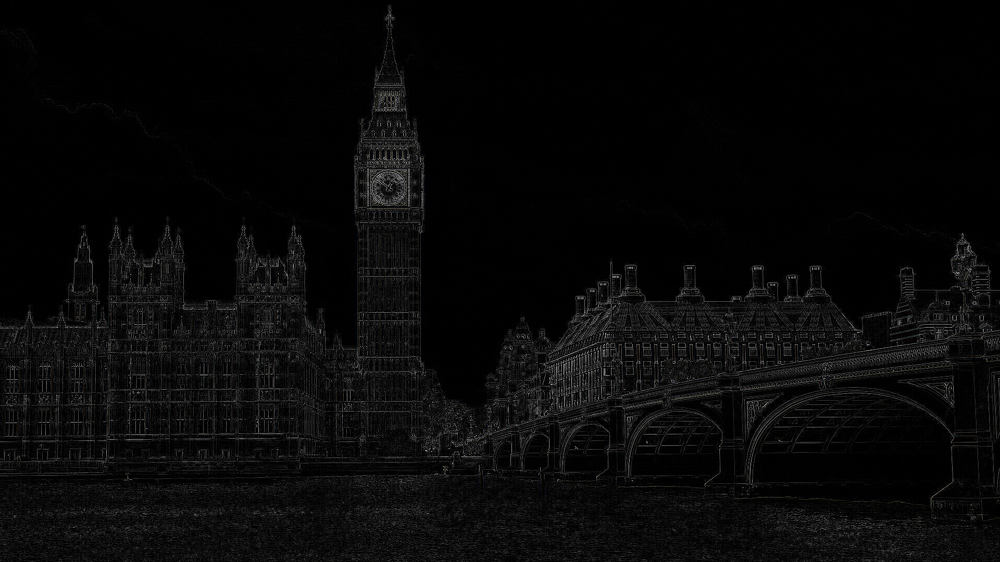

# Image filtering with multithreading

A C++ project demonstrating **image filtering using convolution** and **multithreading**.

The program allows the user to choose from several image filters and processes the image using **1 to 16 threads**. For each thread count, the execution time and speedup are measured.

## Features

* Loading and saving JPG images
* Image padding to preserve the original image dimensions
* Image filtering using convolution kernels
* Multithreaded image processing
* Execution time measurement
* Speedup calculation
* Available filters:

  * Blur 3×3
  * Gaussian Blur 3×3
  * Sharpen 3×3
  * Edge Detection 3×3
  * Blur 9×9

## OSAPI Integration

The project also uses an operating system abstraction layer (OSAPI) developed as part of the OSFES course. The abstraction layer provides a common interface for system-level functionality, allowing its underlying implementation to be adapted or replaced depending on the target operating system. This makes the application more portable across different operating systems.

## How It Works

First, the input image is loaded and padded to handle pixels near the image borders. The image is then processed using a convolution kernel.

The image is divided into sections of rows, which are processed by separate threads. The program runs the filtering process using **1–16 threads** and measures the execution time for each configuration. The speedup is calculated relative to the single-threaded execution.

## Example Results

### Input Image

<!-- Add image here -->

### Blur

<!-- Add image here -->

### Gaussian Blur

<!-- Add image here -->

### Sharpen

<!-- Add image here -->

### Edge Detection

<!-- Add image here -->

